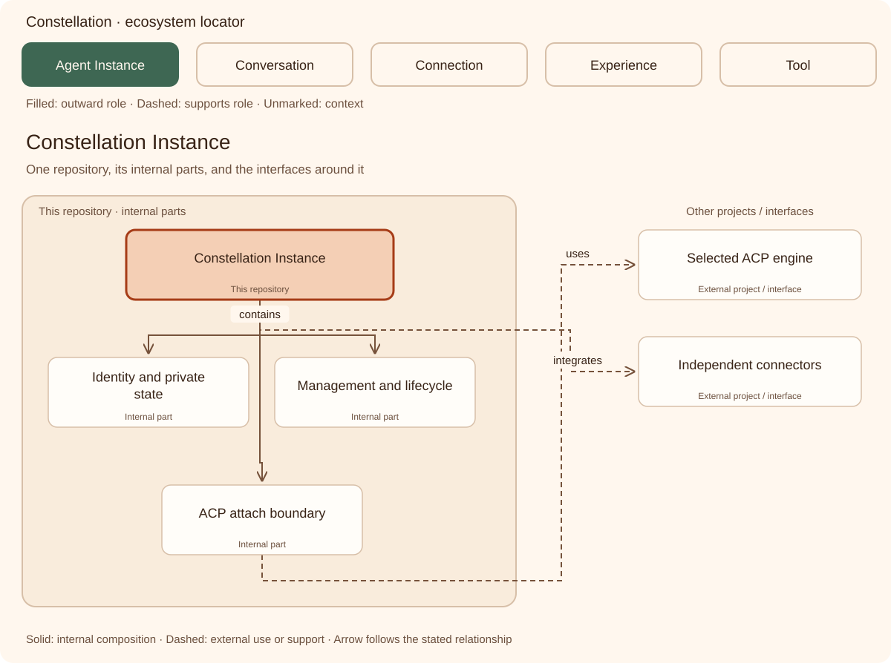

# Constellation Instance

Constellation Instance keeps an installed agent available across clients and
experiences. It manages the agent's identity, configuration, private state, and
lifecycle, while a selected ACP engine performs reasoning and tool execution.

Use it independently or with other
[Constellation components](https://github.com/microsoft/amplifier-constellation).
It includes browser administration, a management API, and an ACP attach command.

## Install an agent

Download the matching **consumer bundle** from
[Releases](https://github.com/microsoft/amplifier-constellation-instance/releases)
and extract it. Keep its files together. The bundle includes the executable,
private Python interpreter, setup support, and the selected native engine; it
needs no developer tools or system Python.

From the extracted folder, run:

```sh
./agent-instance setup --home "/path/to/my-agent" --name "My agent"
```

On Windows, use `agent-instance.exe` with the same arguments. Choose a new private
folder for the installation, then follow the setup output for its address and
sign-in instructions. Connect a model account separately after installation.

Read [native platform setup](docs/native-platforms.md) for OS requirements and
startup behavior. Linux requires an explicit administrator step for the Instance
PAM sign-in policy; setup does not silently change system authentication. Windows
sign-in uses the owning account's password, not a Windows Hello PIN. macOS
executables are unsigned previews.

## Connect a client

Point a compatible ACP client at the installed agent:

```text
command: /path/to/my-agent/bin/agent-instance
args: ["acp", "--home", "/path/to/my-agent"]
```

The engine determines the agent's supported reasoning and tool capabilities.
See the [ACP connection guide](docs/acp-boundary.md) for local and remote access.

## Manage or integrate

- [Native setup, updates and rollback](docs/native-platforms.md).
- [Management API](docs/api.md) for configuration and installation controls.
- [Source installation](docs/install.md) for developers and administrators.
- [Interface map](contracts/README.md) and [validation](docs/validation.md) for contributors.

Each installation keeps its own private files and credentials. An optional fleet
interface is a client of these controls, not a required service.


<!-- ecosystem-map:start -->
## Where this fits

One selected-engine implementation of Agent Instance, with its own identity and lifecycle.

Roles: Agent Instance.



[Open the map](docs/ecosystem-map.svg) · [Product overview](https://microsoft.github.io/amplifier-constellation/projects/amplifier-constellation-instance/) · [Map guide](https://github.com/microsoft/amplifier-constellation/blob/main/docs/ecosystem-maps.md)

<details>
<summary>The five shared building blocks</summary>

[](https://microsoft.github.io/amplifier-constellation/)

</details>

<!-- ecosystem-map:end -->

## Contributing

> [!NOTE]
> This project is not currently accepting external contributions, but we're actively working toward opening this up. We value community input and look forward to collaborating in the future. For now, feel free to fork and experiment!

Most contributions require you to agree to a
Contributor License Agreement (CLA) declaring that you have the right to, and actually do, grant us
the rights to use your contribution. For details, visit [Contributor License Agreements](https://cla.opensource.microsoft.com).

When you submit a pull request, a CLA bot will automatically determine whether you need to provide
a CLA and decorate the PR appropriately (e.g., status check, comment). Simply follow the instructions
provided by the bot. You will only need to do this once across all repos using our CLA.

This project has adopted the [Microsoft Open Source Code of Conduct](https://opensource.microsoft.com/codeofconduct/).
For more information see the [Code of Conduct FAQ](https://opensource.microsoft.com/codeofconduct/faq/) or
contact [opencode@microsoft.com](mailto:opencode@microsoft.com) with any additional questions or comments.

## Trademarks

This project may contain trademarks or logos for projects, products, or services. Authorized use of Microsoft
trademarks or logos is subject to and must follow
[Microsoft's Trademark & Brand Guidelines](https://www.microsoft.com/legal/intellectualproperty/trademarks/usage/general).
Use of Microsoft trademarks or logos in modified versions of this project must not cause confusion or imply Microsoft sponsorship.
Any use of third-party trademarks or logos are subject to those third-party's policies.
