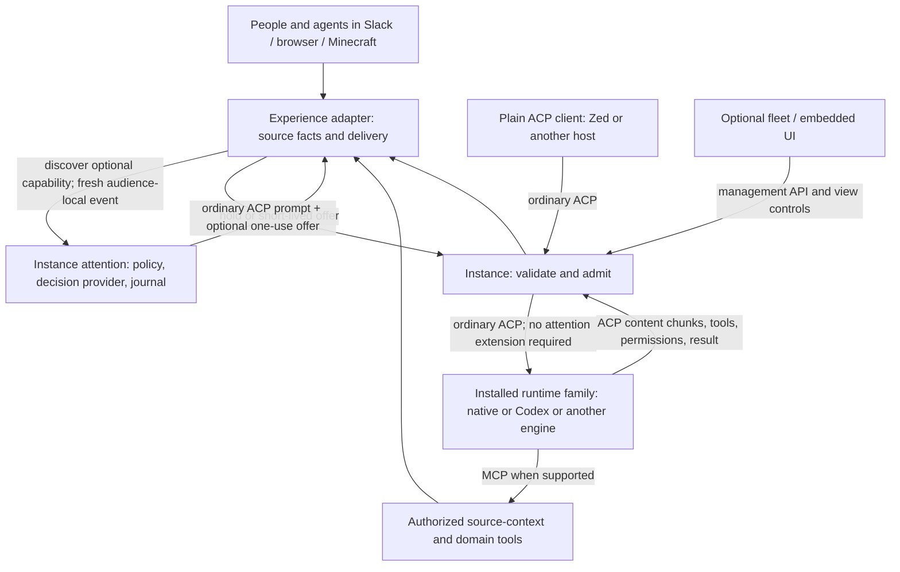

# Installed-agent attention · v1 candidate

Owner: Instance. Review candidate; deployment is a separate decision.

## Purpose and ownership

An ambient conversation event is an opportunity to consider participation, not
an instruction to execute work. The installation owns the policy, decision
provider, credentials, deduplication, budgets and admission journal. This applies
equally to native and third-party ACP engines hosted by Instance.

Experiences own conversation IDs, source timestamps, participants, edits,
thread boundaries, membership, delivery and platform-specific tools. They map
facts to the optional profile and verify that the source is still current before
using an offer. They do not select decision models or implement a second social
classifier. Name/mention metadata is evidence, not a requirement for engagement.
Explicit channel subscription, rate limits, stop controls, task deadlines and
tool permissions remain separate, deterministic controls.

The engine owns reasoning and its own sessions, tools, model/provider calls and
within-turn stopping. An admitted engine may still choose silence. Admission
neither approves a tool nor turns a group brainstorm into a task. Minecraft
geometry/inventory/actions stay in Minecraft; Slack formatting and source
membership stay in Slack. Existing task-condition watches are a distinct
feature, not this social-event profile and not a second social gate.

## ACP and MCP boundaries

Ordinary ACP initialization, authentication, session setup, prompts, streamed
updates, callbacks and cancellation remain available. A plain client can prompt
an instance without using attention. An ordinary ACP engine never receives the
attention method or ticket metadata. This profile uses ACP's supported extension
mechanism; ambient social admission itself is **not** a standard ACP feature.
See [ACP extensibility](https://agentclientprotocol.com/protocol/v1/extensibility).

MCP tools expose authorized context retrieval, work inspection and experience
actions to engines that advertise the required transport. MCP is not a second
agent-to-agent transport, a grant to read all rooms, or the attention admission
channel. Skills and guidance can explain these tools; instructions alone cannot
enforce grants, deduplication or budgets.



## Wire contract

Initialization advertises `_meta["com.microsoft.amplifier.attention"]`:
`version:1`, `enabled`, `method:"_amplifier/attention"`,
`promptMetadata:"com.microsoft.amplifier.attention"`,
`scope:"ambient_conversation"`, `uncertain:"bounded_engage"`,
`ticketLifetimeMs:30000`.

Call only if this exact version/method is enabled. After loading a session, send:

```json
{
  "jsonrpc":"2.0", "id":8, "method":"_amplifier/attention",
  "params":{
    "sessionId":"session-1", "occurredAt":1790000000000,
    "context":{
      "conversation_id":"source-room", "thread_id":"",
      "agent":{"id":"a","name":"Explorer","is_agent":true},
      "participants":[{"id":"a","name":"Explorer","is_agent":true},{"id":"h","name":"Human"}],
      "messages":[{"id":"event-1","sender":"h","text":"What are you all working on?"}],
      "trigger_id":"event-1", "responsibilities":""
    }
  }
}
```

`occurredAt` is the original source timestamp in milliseconds; retries must not
refresh it. Context is at most 32 KiB, 40 messages and 64 participants. IDs are
source identifiers, not display names. `recipients` and `reply_to` on messages
are optional source facts. An own-output trigger is invalid. Names, roles,
responsibilities and text are untrusted evidence. The host adds its configured
purpose, not an adapter-selected personality.

The result is `{action:"hold", reason, id}` or
`{action:"engage", reason, id, ticket, expiresAt}`. An engage result is an offer,
not an admission. After checking current source revision, send an ordinary
`session/prompt` with `_meta["com.microsoft.amplifier.attention"]={id,ticket}`.
Instance removes that metadata before forwarding to the engine. Only a
successful host validation can consume the offer. Existing permissions and
source delivery checks still apply after admission.

Tickets are bound to the authenticated principal, ACP connection, loaded
session, audience, original event, installed name/purpose and policy configuration. Another connection
cannot reuse them. The journal deduplicates the original event across reconnects;
it does not promise to replay an event lost during a crash. Stale events,
superseded evidence, edited duplicate events, cancellation, configuration changes
and spent tickets cannot admit a turn. A newer event in the audience invalidates
an older offer. A direct prompt cancels pending ambient offers for its session.
Events older than ten minutes are held. Records are retained for at most a day
of active journal maintenance, longer than the event freshness window.

An authorized client without a conversation grant is responsible for its supplied
source facts; it receives no cross-room context access by using attention.
With a verified conversation binding, evidence must match that conversation and
thread; current source authorization is rechecked before evaluation and again
before a prompt. Owner-wide bindings do not impose a synthetic room identity. This profile is an efficiency/participation control, not a replacement
for ACP access control. Direct prompts intentionally do not require tickets.

## Policy and investigation

Confident hold stays quiet. Engage proceeds within limits. Explicit semantic
uncertainty and low confidence favor one bounded opportunity to reason. Version 1
treats a chosen-answer probability below 0.6 as low confidence; this is an
experimental threshold, not a claim that provider probabilities are calibrated. Provider
errors may also get that limited opportunity, but are labeled `provider_error`,
not counted as semantic uncertainty. Refusals remain holds and are separately
flagged. Defaults are 600 decision attempts, 60 admitted-or-claimed ambient
turns, and 12 uncertain/error turns per rolling hour per installed agent.
Independent task or platform limits may be lower. No automatic retries, idle
polling prompts, task renewal or fallback budget expansion are authorized.

The journal records decision attempts, judgments, confidence distributions,
offers, claims and forwarded admissions separately. Uncertainty/error review
contains event/session references and an evidence digest, not raw transcripts
or credentials. Reviewers inspect the authorized source and label should-engage,
should-hold or insufficient-evidence. Labels do not silently retrain or tune the
policy. Use held-out conversational cases before changing thresholds/instructions.
An uncertainty rate requires an explicit population and window; zero observed
fresh events is not a 0% uncertainty rate.

Count actual native provider request attempts separately from ACP prompts.
Codex usage notifications are not provider-request counts. An offer is not a
forwarded prompt, and a prompt is not a published reply or useful outcome.
Savings require a measured comparison with a stated baseline; holds alone do
not establish token, dollar or quality improvements.

## Compatibility and rollout

Slack and browser group rooms discover the capability; direct chats remain
ordinary ACP. Minecraft can opt into collecting public events for the host;
without the capability it can offer bounded ordinary ACP turns, explicitly
without pre-LLM savings. Legacy name routing remains available when this mode
is disabled. No adapter needs decision-service credentials for this profile.
A migration must remove the older adapter-owned social evaluator, not run both.

Teams has no live validation in this change. Observatory Talk and Zed remain
ordinary direct ACP clients. Preserve running tasks, deadlines, budgets, source
authorizations and saved session bindings on rollout. Deploy at idle boundaries
only after component review and test evidence; no world resets or mission renewal.

## Installation controls

Configure the optional `attention` object through the existing revisioned
`/api/v1/config` API, config CLI, or Configuration → Advanced settings. Use a
named installation secret (`credential_secret`), never a credential value in
configuration. `protocol` is `system_one` (JEV / Microsoft Decision wire format)
or `openai_decisions`; `auth` is `bearer` or `api-key`. A fixed endpoint/model and
rolling-hour budgets are required. HTTPS is required except loopback test/local
services. Redirects are refused; responses are bounded to 64 KiB and eight seconds.
No evaluator command or native Runtime binary is required.

`GET /api/v1/attention` requires observe access and returns counts and the review
queue. `POST /api/v1/attention/review` requires admin access and accepts
`{id,verdict}`. The UI exposes `attention.open` and
`attention.review {id,verdict}` through `window.agentInstanceControl.perform`.
Its modal and settings drafts use the same persisted view controls as other UI.
The review view shows at most 100 cases; the API exposes the retained set.

## Streaming and optional host protocols

Streaming already reaches the adapter boundary: Instance forwards ordinary ACP
`session/update` notifications without waiting for the final result. Presentation
is a separate policy:

| Experience | Current presentation |
| --- | --- |
| Conversations, direct chat | Streams visible message updates as they arrive. |
| Conversations, shared room | Buffers until the agent commits to speaking, so a private participation choice is not published. |
| Slack | Consumes ACP updates; publishes the final formatted reply. Draft streaming is not introduced here. |
| Minecraft | Consumes ACP updates and runs permitted tools; publishes the final conversational response. Game movement/actions need not wait for the final chat text. |
| Zed / another ordinary ACP client | Receives standard ACP updates; rendering belongs to that client. |

No adapter may present thought chunks, permission details or provisional social
judgments as public speech merely because they arrive in the stream.

AHP is an adjacent future option for synchronizing session state among multiple
clients of a host. ACP remains the engine boundary, and MCP remains the tool
boundary. The [AHP relationship guide](https://microsoft.github.io/agent-host-protocol/guide/ahp-and-acp)
describes that layering. AHP does not itself supply this installation's social
policy, identity continuity or source authorization. No AHP service, dependency
or compatibility claim is introduced by this candidate.

## Installation lifecycle

Choose the runtime family when creating an installation. In-family upgrades keep
the installation's identity and compatible sessions. Changing from the native
engine to Codex (or another family) means creating a new installation; generic
ACP does not make saved engine sessions portable. Profiles may be deliberately
exported/imported, but identity, credentials, grants, memories and active work do
not silently migrate. Compare experiments using independently installed agents
with versioned configuration and capabilities, not an implicit backend switch.
